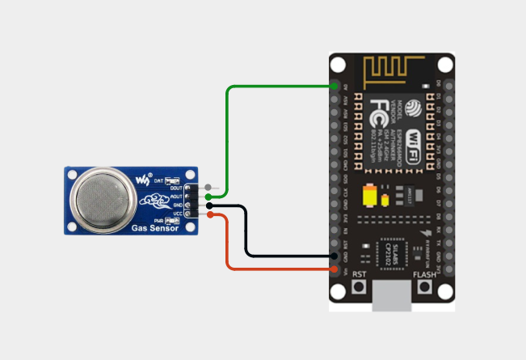
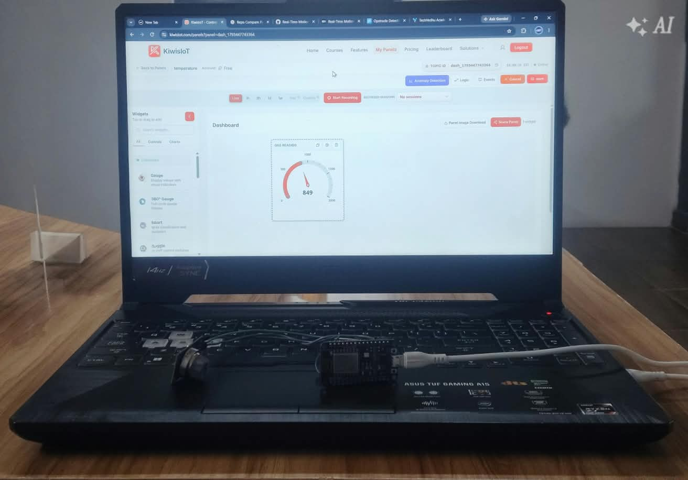
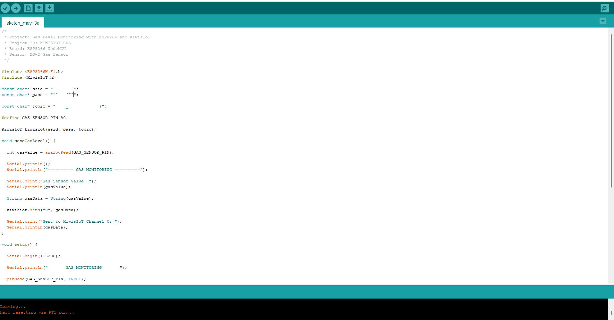

# Smart Gas Monitoring System Using ESP8266 and KiwisIoT

An IoT-based gas sensor monitoring project using an **MQ-2 gas sensor**,
**ESP8266 NodeMCU**, and **KiwisIoT**. The ESP8266 reads the analog
output of the MQ-2 sensor and sends the sensor reading to a KiwisIoT
dashboard over Wi-Fi. A **Gauge** widget displays the received value for
remote monitoring.

> **Important:** This project displays the MQ-2's raw analog sensor
> reading. It does **not** calculate calibrated gas concentration in PPM
> and should not be used as a certified gas-safety or life-safety
> device.

## Project Highlights

-   ESP8266-based gas sensor monitoring
-   MQ-2 gas sensor with analog output
-   Analog reading through the ESP8266 A0 pin
-   Real-time sensor-value monitoring
-   Wi-Fi communication
-   KiwisIoT dashboard integration
-   Gauge widget visualization
-   Serial Monitor output
-   Beginner-friendly IoT project

## Project Overview

The MQ-2 gas sensor module provides an analog output that changes
according to the sensing conditions. In this project, the sensor's
analog output is connected to the **A0** analog input of the ESP8266
NodeMCU.

The ESP8266 reads the sensor using `analogRead()` and sends the
resulting value to **KiwisIoT Channel 0**. A Gauge widget on the
dashboard displays the latest received reading.

### Project Workflow

``` text
MQ-2 Gas Sensor
      |
      v
ESP8266 NodeMCU (A0)
      |
      v
Analog Reading
      |
      v
Gas Sensor Value
      |
      v
Wi-Fi
      |
      v
KiwisIoT Channel 0
      |
      v
Dashboard Gauge Widget
```

## Why This Project?

A gas sensor can be used to observe changes in environmental conditions
and the presence of gases or smoke. Connecting the MQ-2 sensor to an
ESP8266 makes its readings available on an IoT dashboard rather than
relying only on the local Serial Monitor.

This project is a starting point for:

-   Gas sensor value monitoring
-   Smoke-monitoring concepts
-   Indoor environmental monitoring
-   IoT sensor monitoring
-   Smart-home project prototypes
-   Engineering and college IoT projects

## What You'll Learn

By building this project, you will learn how to:

-   Connect an MQ-2 gas sensor module to an ESP8266
-   Read an analog sensor using `analogRead()`
-   Observe changing sensor readings
-   Convert a numeric sensor reading into a string
-   Send sensor data from an ESP8266 to KiwisIoT
-   Use a KiwisIoT channel for sensor data
-   Display readings with a Gauge widget
-   Monitor sensor data remotely over Wi-Fi

## Components Required

  Component                     Quantity
  ------------------------ -------------
  ESP8266 NodeMCU                      1
  MQ-2 Gas Sensor Module               1
  Jumper Wires               As required
  USB Cable                            1
  Computer / Laptop                    1

## Software Requirements

-   Arduino IDE
-   ESP8266 board package
-   KiwisIoT Arduino library
-   KiwisIoT account
-   Wi-Fi connection

### KiwisIoT Setup

Before starting, prepare your KiwisIoT panel and obtain its Topic ID.
Configure a Gauge widget to receive data from Channel 0.

The common KiwisIoT Arduino setup covers:

-   Arduino IDE installation
-   ESP8266 board installation and board selection
-   KiwisIoT Arduino library installation
-   KiwisIoT account and panel setup
-   Topic ID configuration
-   Dashboard widget configuration

## Technologies Used

-   ESP8266 NodeMCU
-   MQ-2 Gas Sensor
-   Arduino IDE
-   Arduino C++
-   KiwisIoT Arduino Library
-   KiwisIoT Dashboard
-   Wi-Fi

## Circuit Connections

The reference project connects the MQ-2 module's analog output to the
ESP8266 A0 pin.

  MQ-2 Gas Sensor Module   ESP8266 NodeMCU
  ------------------------ -----------------
  VCC                      3.3V\*
  GND                      GND
  AO                       A0

The analog output is read in the code using:

``` cpp
int gasValue = analogRead(GAS_SENSOR_PIN);
```

**Hardware check:** The reference connection table lists VCC as 3.3V.
Before powering your circuit, check the specifications of your
particular MQ-2 module and ESP8266 NodeMCU board. MQ-2 modules and
ESP8266 A0 input ranges can vary; ensure the sensor supply and analog
output voltage are within the limits of your exact hardware.

### Circuit Diagram

Add your circuit diagram image to the `images` folder and update the
path below.



### Hardware Setup



## How the Gas Sensor Works

The MQ-2 module provides an analog output that can be read by a
microcontroller. The ESP8266 reads the analog signal through A0 and
stores the result in the `gasValue` variable.

``` cpp
int gasValue = analogRead(GAS_SENSOR_PIN);
```

The value is converted into a string before it is sent to KiwisIoT:

``` cpp
String gasData = String(gasValue);
```

The project sends the reading to Channel 0:

``` cpp
kiwisiot.send("0", gasData);
```

### Sensor Data Flow

``` text
MQ-2 Gas Sensor
      |
      v
Analog Output
      |
      v
ESP8266 A0
      |
      v
analogRead()
      |
      v
Raw Gas Sensor Value
      |
      v
KiwisIoT Channel 0
      |
      v
Gauge Widget
```

> **Reading note:** Values such as `821`, `801`, and `775` are examples
> of raw readings from the reference project. Actual readings depend on
> the sensor, module, operating conditions, environment, and hardware.
> They are not calibrated gas concentrations.

## KiwisIoT Dashboard Configuration

Create a KiwisIoT panel and add a **Gauge** widget to display the sensor
reading.

  Setting       Value
  ------------- -------------------------
  Widget        Gauge
  Widget Name   Gas Level
  Channel ID    0
  Data          Raw MQ-2 analog reading

The Arduino code sends the value using:

``` cpp
kiwisiot.send("0", gasData);
```

Make sure the Channel ID configured in the dashboard matches the channel
used in the code.

### Dashboard Preview

Add your dashboard screenshot to the `images` folder and update the path
below.


## Configure Wi-Fi and KiwisIoT

Before uploading the program, replace the placeholders with your own
details:

``` cpp
const char* ssid = "YOUR_WIFI_NAME";
const char* pass = "YOUR_WIFI_PASSWORD";

const char* topic = "YOUR_DASHBOARD_TOPIC_ID";
```

Replace:

-   `YOUR_WIFI_NAME` with your Wi-Fi network name.
-   `YOUR_WIFI_PASSWORD` with your Wi-Fi password.
-   `YOUR_DASHBOARD_TOPIC_ID` with the Topic ID of your KiwisIoT panel.

**Security:** Do not publish your actual Wi-Fi password, API keys,
access tokens, or private credentials in a public GitHub repository.
Keep real credentials in your local project.

## Complete Arduino Code

Save the following code as `esp8266-gas-kiwisiot.ino`.

### Arduino IDE



### coding

``` cpp

#include <ESP8266WiFi.h>
#include <KiwisIoT.h>

const char* ssid = "YOUR_WIFI_NAME";
const char* pass = "YOUR_WIFI_PASSWORD";

const char* topic = "YOUR_DASHBOARD_TOPIC_ID";

#define GAS_SENSOR_PIN A0

KiwisIoT kiwisiot(ssid, pass, topic);

void sendGasLevel() {

  int gasValue = analogRead(GAS_SENSOR_PIN);

  Serial.println();
  Serial.println("---------- GAS MONITORING ----------");

  Serial.print("Gas Sensor Value: ");
  Serial.println(gasValue);

  String gasData = String(gasValue);

  kiwisiot.send("0", gasData);

  Serial.print("Sent to KiwisIoT Channel 0: ");
  Serial.println(gasData);
}

void setup() {

  Serial.begin(115200);

  Serial.println("       GAS MONITORING       ");

  pinMode(GAS_SENSOR_PIN, INPUT);

  Serial.println("Gas sensor initialized");

  Serial.println("Connecting to KiwisIoT...");

  kiwisiot.begin();

  Serial.println("KiwisIoT initialized");
  Serial.println("Starting gas monitoring...");
}

void loop() {

  kiwisiot.run();

  static unsigned long lastSend = 0;

  if (millis() - lastSend >= 2000) {

    lastSend = millis();

    sendGasLevel();
  }

  delay(100);
}
```

## Upload Instructions

1.  Connect the ESP8266 NodeMCU to your computer using a USB cable.
2.  Open Arduino IDE.
3.  Install the ESP8266 board package and KiwisIoT Arduino library.
4.  Open `esp8266-gas-kiwisiot.ino`.
5.  Select the correct ESP8266 board and COM port.
6.  Enter your Wi-Fi name, Wi-Fi password, and KiwisIoT Topic ID in the
    code.
7.  Verify and upload the program.
8.  Open the Serial Monitor and set the baud rate to **115200**.
9.  Check that sensor readings appear and that the dashboard receives
    them.

## Expected Serial Monitor Output

The ESP8266 prints the sensor reading and the KiwisIoT transmission
message. Example output:

``` text
---------- GAS MONITORING ----------
Gas Sensor Value: 821
Sent to KiwisIoT Channel 0: 821

---------- GAS MONITORING ----------
Gas Sensor Value: 801
Sent to KiwisIoT Channel 0: 801

---------- GAS MONITORING ----------
Gas Sensor Value: 775
Sent to KiwisIoT Channel 0: 775
```

The program reads and sends the sensor value approximately every **two
seconds**.

Add your Serial Monitor screenshot to the `images` folder and update the
path below.


## Testing the Project

1.  Power the MQ-2 module and ESP8266 using the supply arrangement
    appropriate for your hardware.
2.  Allow the sensor to warm up and stabilize according to the module's
    documentation.
3.  Open the Serial Monitor at 115200 baud.
4.  Observe the raw analog readings.
5.  Check that the readings are sent to KiwisIoT Channel 0.
6.  Confirm that the Gauge widget displays the received value.
7.  Observe how the reading changes under different environmental
    conditions.

The dashboard should update as new sensor readings arrive.

> Changes in the raw sensor reading indicate changes in the sensor
> output. Do not interpret them as a specific gas concentration without
> suitable calibration and processing.

## Troubleshooting

### Gas Sensor Value Does Not Appear

Check:

-   VCC and GND connections
-   AO connection to A0
-   Sensor power supply
-   Sensor module and wiring
-   ESP8266 board selection
-   Serial Monitor baud rate

### Sensor Value Remains Unchanged

Check:

-   AO connection
-   Sensor power supply
-   Sensor module and wiring
-   Sensor operating conditions
-   Sensor stabilization time

### Dashboard Does Not Receive Data

Check:

-   Wi-Fi name and password
-   Internet connection
-   KiwisIoT Topic ID
-   Channel ID
-   Dashboard widget configuration
-   KiwisIoT Arduino library
-   ESP8266 connection

### Gauge Shows No Value

Confirm that the Gauge widget uses **Channel ID 0**. The ESP8266 sends
the reading using:

``` cpp
kiwisiot.send("0", gasData);
```

The channel configured in the dashboard must match the channel used in
the code.

### Sensor Values Change Frequently

MQ-2 readings can vary with the sensor, environment, power conditions,
and surrounding conditions. Check the wiring, power supply, sensor
placement, and stabilization time.

## Possible Applications

This project can be used as a starting point for:

-   Gas sensor value monitoring
-   Smoke-monitoring concepts
-   Indoor environmental monitoring
-   Smart-home IoT prototypes
-   Industrial monitoring concepts
-   Engineering and college IoT projects

It can be extended with LEDs, buzzers, relays, alerts, thresholds,
additional sensors, and automation logic. This prototype is not a
substitute for certified gas alarms or safety equipment.

## Future Improvements

-   Add LED indicators for configurable sensor-reading ranges.
-   Add a buzzer alert for a configured threshold.
-   Add notifications through an IoT service.
-   Add data logging and historical graphs.
-   Add additional environmental sensors.
-   Implement calibrated gas-concentration estimation with suitable
    calibration and validation.

## Project Structure

``` text
006-gas-kiwisiot/
|
|-- README.md
|
|-- code/
|   `-- esp8266-gas-kiwisiot.ino
|
`-- images/
    |-- circuit.png
    |-- code.png
    |-- serial-monitor.png
    `-- dashboard-output.png
```

Place your actual screenshots and circuit image in the `images` folder.
If your filenames differ, update the image paths in this README.

## Related KiwisIoT ESP8266 Projects

This project belongs to the KiwisIoT ESP8266 IoT project collection.
Related projects listed in the reference include:

-   ESP8266 LDR Sensor IoT Project
-   ESP8266 IR Sensor IoT Project
-   ESP8266 Ultrasonic Sensor IoT Project
-   ESP8266 DHT11 Temperature & Humidity IoT Project
-   ESP8266 PIR Motion Sensor IoT Project
-   ESP8266 Flame Sensor IoT Project
-   ESP8266 Soil Moisture IoT Project

## Frequently Asked Questions

### What is an MQ-2 gas sensor?

The MQ-2 is a gas sensor module commonly used to detect changes
associated with combustible gases and smoke.

### Which ESP8266 pin is used in this project?

The MQ-2 module's analog output (AO) is connected to **A0**.

### Which KiwisIoT channel is used?

The project sends the gas sensor reading to **Channel 0**.

### Which dashboard widget is used?

A **Gauge** widget displays the received sensor value.

### Does this project measure gas concentration in PPM?

No. It sends the raw analog sensor reading to KiwisIoT. A calibrated gas
concentration measurement requires appropriate calibration and
additional processing.

### How often is the sensor value sent?

The program sends a reading approximately every **two seconds**.

### Can this project be extended?

Yes. LEDs, buzzers, relays, alerts, thresholds, additional sensors, and
automation logic can be added.

## Summary

This project demonstrates an IoT-based gas sensor monitoring system
using an **MQ-2 gas sensor**, **ESP8266 NodeMCU**, and **KiwisIoT**. The
ESP8266 reads the sensor's analog output through A0 and sends the raw
reading over Wi-Fi to KiwisIoT Channel 0. A Gauge widget displays the
received value on the dashboard.

It provides a practical introduction to connecting an analog sensor to
an ESP8266 and monitoring its readings remotely through an IoT platform.

**Remember:** The displayed value is a raw sensor reading, not a
calibrated gas concentration in PPM or a certified safety measurement.

## License

Add a `LICENSE` file to the repository if you intend to publish this
project under an open-source license. The reference project specifies
MIT License; use it only if you intend to release your own project under
those terms.
